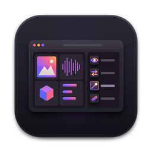
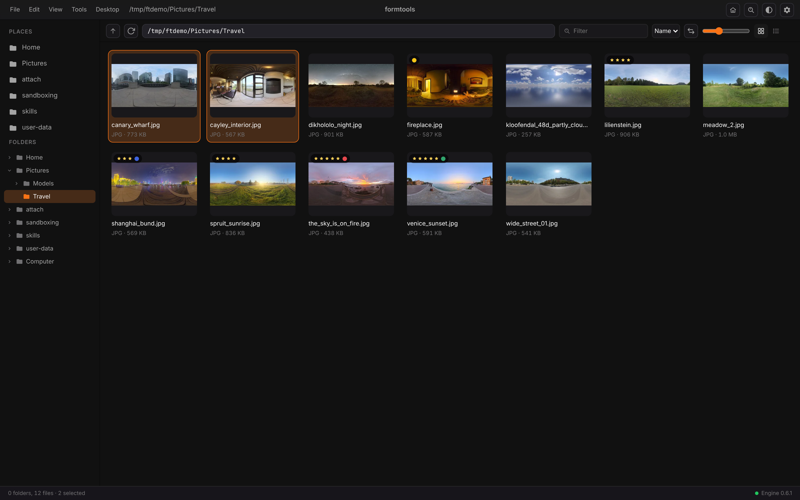
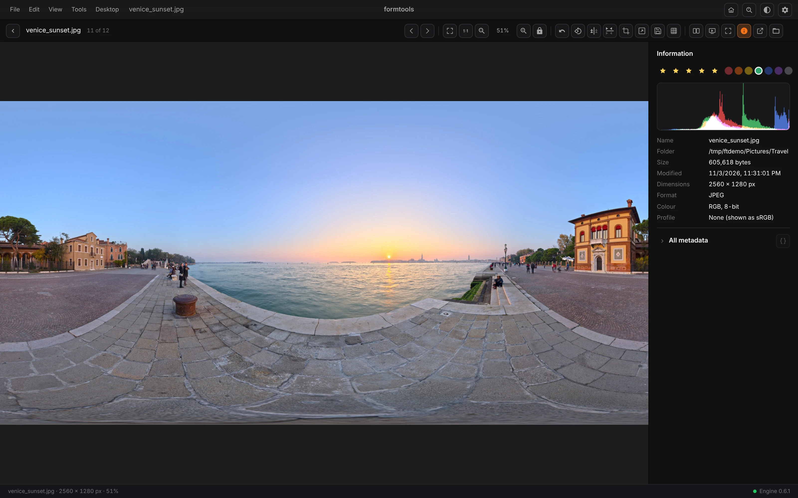
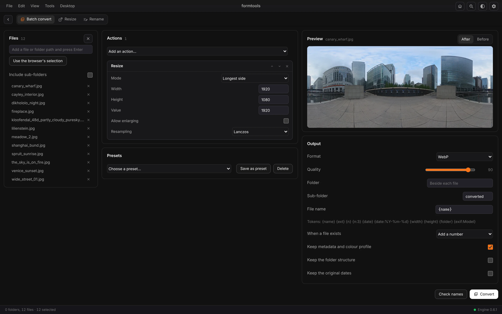
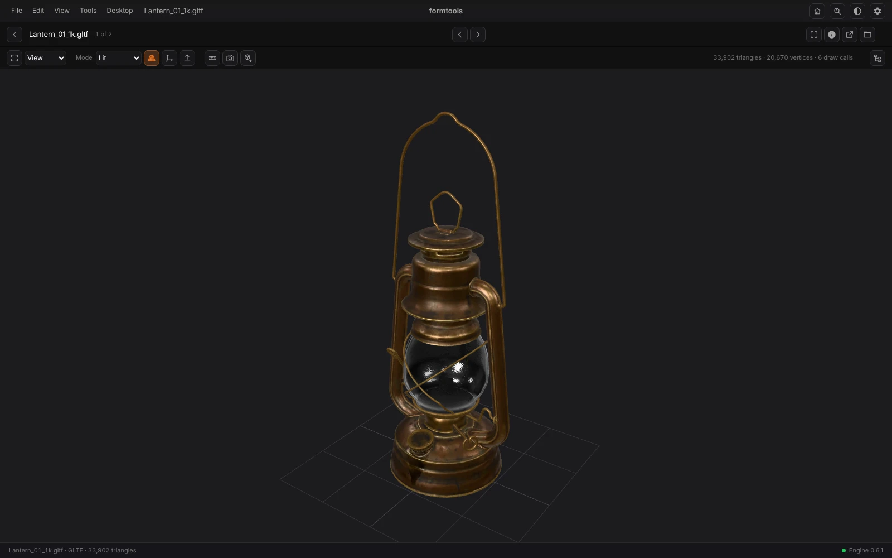

<p align="center">
  
</p>

<h1 align="center">FormTools</h1>

<p align="center">
  <b>Media and file utilities; the Form family's utility belt.</b><br>
  Viewers for almost any file, batch image tools, 3D viewing and desktop utilities,<br>
  in one window with no account. Local, and yours.
</p>

<p align="center">
  
  
  
  
  
  
</p>

<p align="center">
  <a href="https://formai.studio/"><b>Download FormTools on formai.studio</b></a> ·
  <a href="#run-it-from-source">Run it from source</a>
</p>

<br>

<p align="center">
  
  <br>
  <sub>The folder browser: thumbnails, star ratings, colour labels and multi-select.</sub>
</p>

<p align="center">
  <a href="#features">Features</a> ·
  <a href="#everything-in-the-box">In the box</a> ·
  <a href="#built-for-agents">Agents</a> ·
  <a href="#under-the-hood">Under the hood</a> ·
  <a href="#download">Download</a> ·
  <a href="#run-it-from-source">Run from source</a>
</p>

<br>

<table>
  <tr>
    <td width="25%" valign="top"><h3>View anything</h3>Open RAW, HDR, EXR, PSD, video, audio, 3D models, fonts, PDFs, databases and archives in one app.</td>
    <td width="25%" valign="top"><h3>Batch images</h3>Convert, resize and rename whole folders with an ordered action pipeline, a live preview and shared presets.</td>
    <td width="25%" valign="top"><h3>Desktop utilities</h3>Colour picker, screen ruler, text extractor, zoom and draw, break timer and more, on global shortcuts.</td>
    <td width="25%" valign="top"><h3>Agent-ready</h3>The same engine from the window, the CLI and an MCP server with 35 tools.</td>
  </tr>
</table>

## Features

<table>
  <tr>
    <td width="33%" valign="top">
      
      <br><sub>The image viewer with the information panel.</sub>
      <h3>Image viewer</h3>Crop, resize, save as, compare and inspect pixels. Rate and label from the keyboard.
    </td>
    <td width="33%" valign="top">
      
      <br><sub>Batch convert: twelve photos, a resize action, WebP output.</sub>
      <h3>Batch convert</h3>Chain actions, pick a format and naming tokens, check the names, then convert. Undo is built in.
    </td>
    <td width="33%" valign="top">
      
      <br><sub>The 3D viewer with a glTF lantern.</sub>
      <h3>3D viewer</h3>View, measure and inspect models, play animation, and convert to GLB, OBJ, STL, PLY or OFF.
    </td>
  </tr>
</table>

## Everything in the box

<table>
  <tr>
    <td width="33%" valign="top"><h4>Viewers</h4>Folder browser · Image viewer · Player · Media info · 3D viewer · Text, code and data · Archives · Fonts · Form projects</td>
    <td width="33%" valign="top"><h4>Tools</h4>Batch convert · Resize · Rename · Checksums · Duplicates · Disk usage · Clean up · New from template · Who has this open</td>
    <td width="33%" valign="top"><h4>Formats</h4>Opens: JPEG, PNG, WebP, AVIF, TIFF, RAW, PSD, EXR, HDR, SVG, GIF, JXL, HEIC, MP4, glTF, CSV, JSON, SQLite, PDF · Saves: JPEG, PNG, WebP, AVIF, TIFF, BMP, GIF</td>
  </tr>
</table>

Desktop utilities: colour picker · screen ruler · text extractor · zoom and draw · break timer · Awake · always on top · hosts file · environment variables.

## Built for agents

35 MCP tools, one engine; the window, the CLI and the MCP server call the same code.

```sh
./formtools cli convert --format webp --out ~/Pictures/web ~/Pictures/trip   # batch convert
./formtools cli resize --longest 2048 ~/Pictures/trip                        # resize
./formtools cli rename --find IMG --replace trip --counter ~/Pictures/trip/* # print the plan; add --apply
./formtools mcp                                                              # MCP server on stdio for Claude Code, Codex and Cursor
./formtools agents install                                                   # connect Claude Code, Codex and Cursor for your user account
```

`.mcp.json`, `.codex/config.toml` and `.cursor/mcp.json` are already wired in this repo. See [`AGENTS.md`](AGENTS.md).

**Terminal.** A dock above the status bar holds real terminals run by the engine: your login shell in as many tabs as you like, kept running while the dock is hidden. Open it with the Terminal button in the title bar or View > Terminal (Mod+J).

**Claude Code.** If Claude Code is installed, a Claude Code tab (Mod+Shift+J) starts your own `claude` with formtools' MCP tools already attached, and the Chat tab (Mod+Alt+J) talks to it in a chat with Allow and Deny cards for each step, then hands the conversation to a Claude Code tab when you want the full terminal. formtools does not bundle Claude Code and never reads or stores its sign-in; if it is missing, the dock shows the one-line install. Agents cannot open terminals or Claude Code through MCP: those stay yours.

## Under the hood

- **Window:** vanilla TypeScript and Vite, on port 5240 in development.
- **Engine:** Python and FastAPI on 127.0.0.1:8240, with 8 tool modules registered at start.
- **Desktop:** a Tauri 2 shell that starts its own engine on a free port.
- **Local:** every file is read on this computer and nothing is uploaded.
- **Media:** FFmpeg (LGPL build) for playback, inspection and lossless clips; transcoding stays in FormEncoder.
- **Checked in CI:** frontend build, type check, byte-compile of the engine and the agents kit.

## Download

| Platform | Download | Release |
|---|---|---|
| macOS | [Download FormTools for macOS](https://formai.studio/get/formtools/macos) | [FormTools releases on FormCompiler](https://github.com/nodemode-dev/formcompiler/releases?q=formtools-v&expanded=true) |
| Windows | [Download FormTools for Windows](https://formai.studio/get/formtools/windows) | [FormTools releases on FormCompiler](https://github.com/nodemode-dev/formcompiler/releases?q=formtools-v&expanded=true) |
| Linux | [Download FormTools for Linux](https://formai.studio/get/formtools/linux) | [FormTools releases on FormCompiler](https://github.com/nodemode-dev/formcompiler/releases?q=formtools-v&expanded=true) |

All FormTools builds are compiled and released from [FormCompiler](https://github.com/nodemode-dev/formcompiler); this repo holds the source.

## Demo

[`demo/index.html`](demo/index.html) is an offline demo that opens from `file://` or any static server and runs the real FormTools window on A photo shoot, the demo folder the engine generates: browse it, open every picture in the viewer with its information, and see Find Duplicates, Clean Up, Disk Usage and Checksums on it. FormTools does its work in its engine, so the page replays answers recorded from the real engine for that folder; anything not recorded says it needs the engine. See [`demo/README.md`](demo/README.md) for what is live and what is replayed. Two more pages of the same window link to each other and to it from the status bar:

- [`demos/family/index.html`](demos/family/index.html): A shelf of Form files, with a formvis project, a PDF, a database, a font, an archive, data and code, and a checksum file to verify. See [`demos/family/README.md`](demos/family/README.md).
- [`demos/bench/index.html`](demos/bench/index.html): 3D and media bench, with a GLB scene, OBJ, STL, PLY and OFF models in the 3D viewer, a sweep and a chord to play, and a short video. See [`demos/bench/README.md`](demos/bench/README.md).

The same three demos open inside the app from Home, from Help > Demos, or with the `demo-photos`, `demo-family` and `demo-bench` commands, each as a folder the engine makes on your computer.

## Run it from source

Prefer it in your browser, or want to contribute? Run the web UI straight from this repo.

**Requires:** Python 3.12 or newer, and Node.js 20.19+ or 22.12+. The desktop window also needs Rust.

```sh
git clone git@github.com:nodemode-dev/formtools.git
cd formtools
./formtools_oc_install     # backend venv, Python packages, frontend packages
./formtools                # engine on :8240 and the web UI at http://127.0.0.1:5240
```

The engine listens on 127.0.0.1:8240 (`FORMTOOLS_PORT`). `./formtools desktop dev` opens the desktop window instead (run `./formtools install-desktop` first). On Windows use `formtools_oc_install.bat` and `formtools.bat`.

> [!IMPORTANT]
> **Status:** alpha. Features are broad and still being hardened; the 3D viewer needs WebGL. See [`CHANGELOG.md`](CHANGELOG.md).

**Contributing:** branch from `main`, keep changes to source here, and leave packaging and releases to FormCompiler. See [`AGENTS.md`](AGENTS.md).

## Repository

| Path | What it is |
|---|---|
| `frontend/` | Vanilla TypeScript and Vite window: Home, browser, viewer, Preferences, command palette |
| `backend/` | Python and FastAPI engine: file listing, image decoding, project reader, MCP |
| `src-tauri/` | Tauri 2 desktop shell: splash, window, menus, file dialogs |
| `setup/` | The scripts behind `./formtools` |
| `docs/` | Encyclopedia of comparable tools and how FormTools reads Form project files |

Docs: [`docs/encyclopedia`](docs/encyclopedia) · Agents: [`CLAUDE.md`](CLAUDE.md), [`AGENTS.md`](AGENTS.md)

<br>

---

## Maintainers

| Maintainer | Role |
|---|---|
| [@nodemode-ai](https://github.com/nodemode-ai) | Owner |
| [@gbarnai](https://github.com/gbarnai) | Co-owner |

Code owners are set in [`.github/CODEOWNERS`](.github/CODEOWNERS).

## License

FormTools is licensed under the Apache License, Version 2.0 ([`LICENSE`](LICENSE), SPDX `Apache-2.0`). Copyright (C) 2026 NodeAgentc, Inc. Third-party notices: [`NOTICE.md`](NOTICE.md).

<sub>Screenshot content: CC0 photos and models from Poly Haven.</sub>
